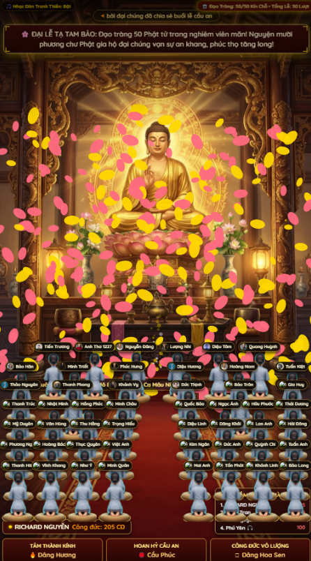
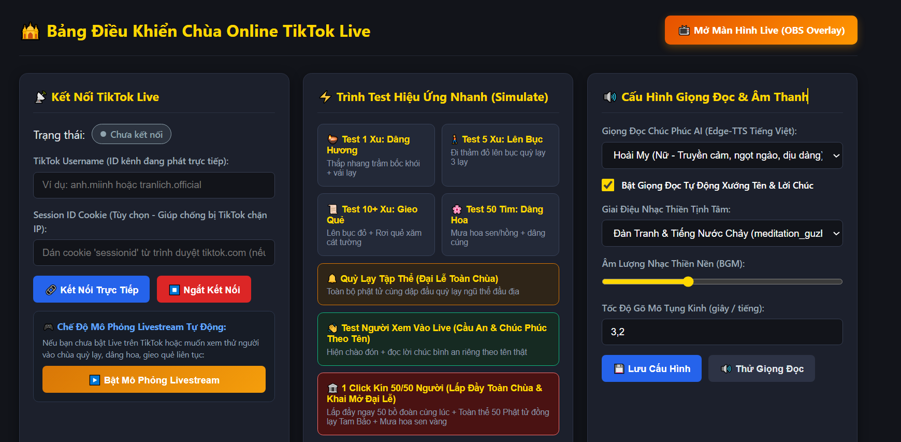
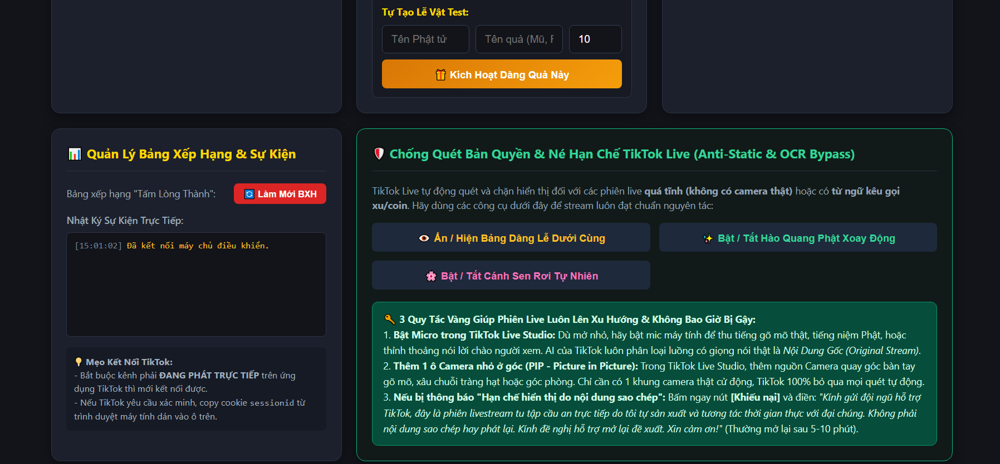
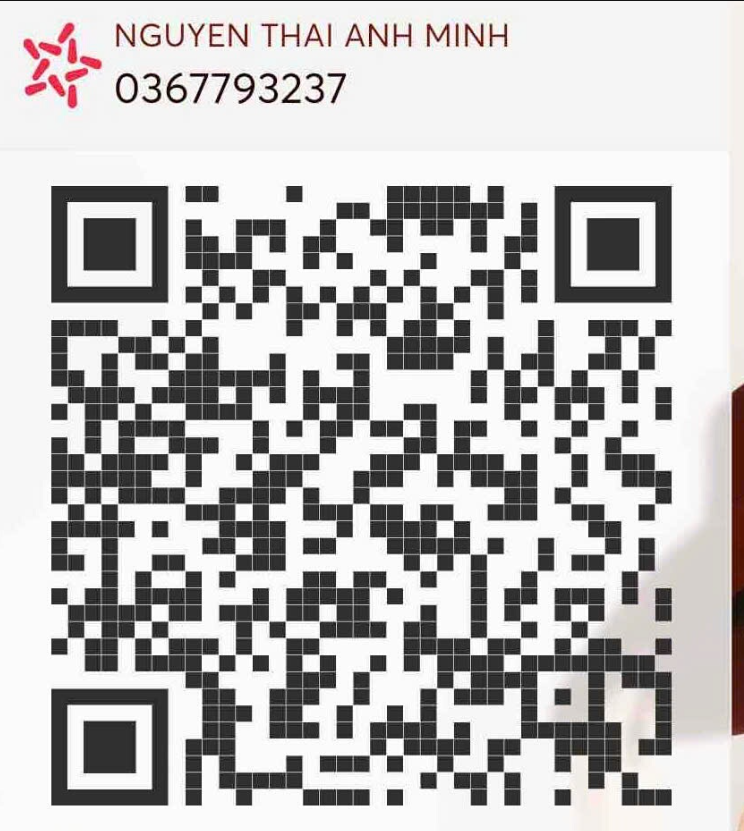

# Chùa Online TikTok Live (Đi Chùa Cầu An Online)

Ứng dụng tương tác livestream TikTok với chủ đề **"Đi Chùa Cầu An - Gõ Mõ - Bốc Quẻ - Công Đức"**. Dự án cho phép kết nối trực tiếp với TikTok Livestream để nhận diện người xem bình luận, thả tim, gửi quà (quét quẻ / gõ mõ / đọc sớ / cập nhật bảng vàng công đức bằng giọng đọc AI TTS tự động).

---

## 📸 Demo Giao Diện Ứng Dụng

<p align="center">
  <b>Màn hình Live Stream thực tế (Tỷ lệ khung dọc điện thoại / OBS):</b><br/>
  
</p>

<p align="center">
  <b>Giao diện Bốc Quẻ, Bảng Vàng & Bảng Điều Khiển Admin:</b><br/>
  
  
</p>

---

## 🌟 Tính Năng Nổi Bật

- 🔔 **Mõ Tự Động & Thủ Công**: Tự động gõ mõ tích công đức khi có tương tác (comment, like, gift), hiển thị hiệu ứng khói/hoa sen/phật quang đẹp mắt.
- 📜 **Bốc Quẻ & Đọc Sớ Tự Động**: Tự động lấy tên người xem và bốc quẻ cầu an ngẫu nhiên từ kho `fortunes.json`.
- 🗣️ **Tích hợp Giọng Đọc AI (TTS)**: Đọc lời chúc cầu bình an, đọc quẻ bằng âm thanh AI tiếng Việt mượt mà.
- 🏆 **Bảng Vàng Công Đức**: Xếp hạng top các "Phật tử online" donate / gửi quà nhiều nhất theo thời gian thực.
- 🎛️ **Bảng Điều Khiển Admin (Dashboard)**:
  - Nhập username TikTok streamer để kết nối trực tiếp.
  - Chế độ giả lập (Simulation) để test đầy đủ hiệu ứng âm thanh, quà tặng mà không cần phải bật live thật.
  - Tùy chỉnh danh sách quẻ, âm lượng, giọng đọc.
- 🖥️ **Giao diện OBS / TikTok Live Studio**: Thiết kế chuẩn tỷ lệ màn hình dọc cho điện thoại hoặc khung dọc màn hình livestream.

---

## 🚀 Hướng Dẫn Cài Đặt & Sử Dụng Nhanh

### 1. Yêu cầu hệ thống
- Máy tính cài đặt sẵn **[Node.js](https://nodejs.org/)** (khuyến nghị phiên bản LTS v18 trở lên).
- Python (tùy chọn nếu muốn chạy module `tts_service.py` tùy biến sâu).

### 2. Khởi chạy nhanh bằng 1 click
Trong thư mục dự án `LiveTikTokDiChuaCauAn`:
- Nhấp đúp chuột vào file **`start_app.bat`**.
- File script sẽ tự động kiểm tra cài đặt thư viện (`npm install` nếu chưa có) và khởi động máy chủ tại cổng `3000`.
- Trình duyệt sẽ tự động mở 2 trang:
  1. **Màn hình Overlay Live**: `http://localhost:3000/index.html` (Dùng để đưa vào OBS / TikTok Live Studio).
  2. **Trang Quản Trị Admin**: `http://localhost:3000/admin.html` (Dùng để quản lý kết nối, test hiệu ứng).

### 3. Chạy thủ công bằng dòng lệnh (Terminal / CMD)
```bash
# Cài đặt các thư viện cần thiết
npm install

# Khởi động máy chủ
npm start
```
Truy cập:
- **Giao diện Live Overlay**: [http://localhost:3000](http://localhost:3000)
- **Trang Admin**: [http://localhost:3000/admin.html](http://localhost:3000/admin.html)

### 4. Đưa vào phần mềm Livestream (OBS Studio / TikTok Live Studio)
1. Thêm nguồn mới: Chọn **Browser Source** (Trình duyệt).
2. Điền URL: `http://localhost:3000/index.html`
3. Đặt kích thước (khuyên dùng):
   - Chiều rộng (Width): `1080` (hoặc `720`)
   - Chiều cao (Height): `1920` (hoặc `1280`)
4. Đánh dấu tích vào: *"Control audio via OBS"* (Kiểm soát âm thanh qua OBS) nếu cần quản lý âm lượng riêng.

---

## ☕ Mời Tác Giả Ly Cà Phê (Donate / Buy Me a Coffee)

Nếu bạn thấy dự án hữu ích hoặc giúp bạn livestream giải trí vui vẻ hơn, bạn có thể ủng hộ tác giả ly cafe để có thêm động lực duy trì và phát triển thêm nhiều tính năng mới nhé! ☕🙏

<p align="center">
  
  <br/>
  <b>Quét mã QR để gửi chút tấm lòng cà phê cho tác giả ☕❤️</b>
</p>

### 💖 Lời Cảm Ơn Chân Thành
> *"Cảm ơn anh em rất nhiều vì đã ủng hộ và đồng hành cùng dự án! Mỗi ly cà phê, sự động viên hay góp ý của anh em đều là nguồn động lực to lớn giúp mình tiếp tục hoàn thiện, tối ưu và chia sẻ thêm nhiều công cụ hữu ích cho cộng đồng. Chúc anh em livestream rực rỡ, vạn sự hanh thông và gặt hái được thật nhiều thành công!"* 🙏✨

---

## 📁 Cấu Trúc Thư Mục

```
LiveTikTokDiChuaCauAn/
├── README.md               # Tài liệu giới thiệu & hướng dẫn sử dụng
├── server.js               # Máy chủ Node.js & Socket.io xử lý sự kiện TikTok
├── package.json            # Danh sách dependencies
├── fortunes.json           # Danh sách các câu chúc, quẻ bói cầu an
├── start_app.bat           # File chạy nhanh ứng dụng cho Windows
├── install_dependencies.bat# File cài đặt thư viện nhanh
├── tts_service.py          # Script Python hỗ trợ TTS (tùy chọn)
├── demo.png                # Ảnh chụp demo giao diện live
├── demo2.png               # Ảnh chụp demo bốc quẻ / bảng vàng
├── demo3.png               # Ảnh chụp demo trang quản trị admin
├── QRGuiCfChoToiiii.png    # Mã QR nhận ủng hộ cà phê
└── public/
    ├── index.html          # Màn hình hiển thị livestream chính (OBS)
    ├── admin.html          # Trang quản trị, kết nối tài khoản & thử nghiệm
    ├── css/                # Giao diện CSS
    ├── js/                 # Javascript xử lý âm thanh, socket, hiệu ứng
    └── assets/             # Âm thanh chuông gõ mõ, hình ảnh phật, hoa sen
```

---

## ⚠️ Lưu Ý & Miễn Trừ Trách Nhiệm

- Dự án phục vụ mục đích giải trí, cầu an và trải nghiệm công nghệ livestream tương tác.
- Hãy tuân thủ tiêu chuẩn cộng đồng của TikTok khi phát trực tiếp.
